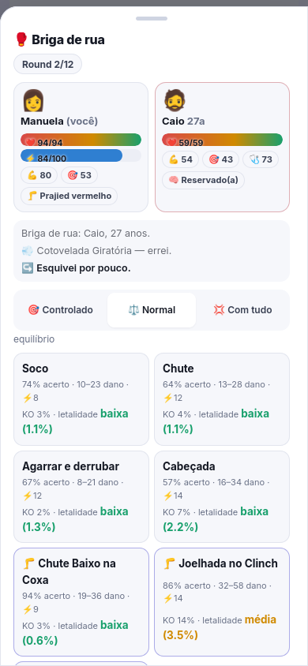
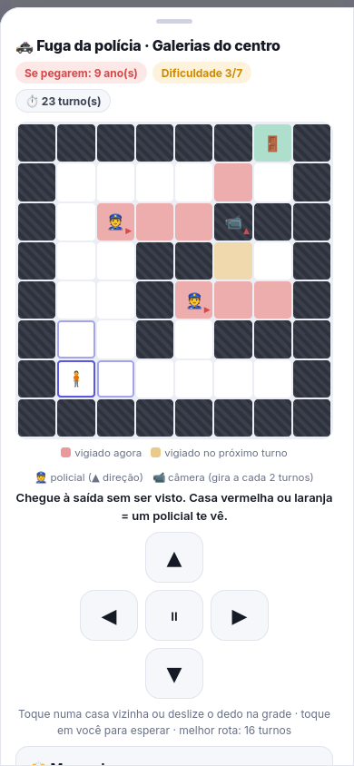
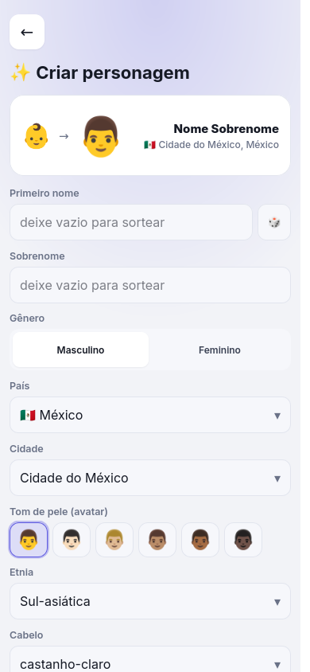
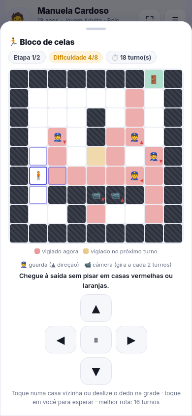
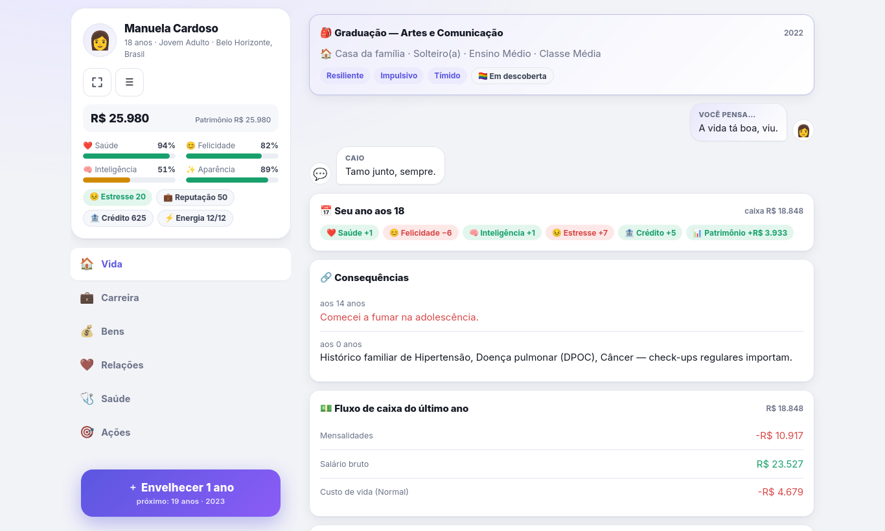

<div align="center">


# ClaudiLife

**Um simulador de vida completo, do nascimento ao legado.**
Você nasce num país e numa classe social sorteados, e cada escolha muda o resto da vida.


</div>

<p align="center">
  
  
  
  
</p>

---

## Sobre o jogo

ClaudiLife é um simulador de vida em texto e decisões, no estilo dos "life sims" para celular. Cada toque em **Envelhecer 1 ano** passa um ano inteiro de simulação: salário e contas, economia do país, saúde, relações, envelhecimento e eventos aleatórios que pedem uma decisão sua.

Não existe caminho certo. Dá para ser médico, jogador de futebol, streamer, político, dono de um império imobiliário em três países, chefe de uma organização criminosa ou alguém que passou a vida inteira cuidando da família. No fim, a vida vira um legado: título, pontuação, linha do tempo e a chance de continuar a história como um dos seus filhos.

O jogo roda inteiro no navegador, sem instalar nada e sem servidor. Funciona offline, cabe num único arquivo HTML e pode ser instalado no celular como app.

## Destaques

- **Causa e efeito de verdade.** Escolhas voltam anos depois: a cola na prova vira investigação, o dinheiro emprestado volta (ou não), o golpe no cônjuge é descoberto.
- **Chances explicadas.** Entrevistas, crimes, tratamentos e recursos mostram a porcentagem e os fatores que pesam a favor ou contra.
- **Economia que importa.** Ciclos de expansão, recessão e crise, inflação, juros, imposto progressivo, crédito, leilão de imóvel por inadimplência e câmbio entre 8 países.
- **Minigames.** Combate por turnos com golpes de artes marciais, fuga da prisão e perseguição policial em grade, todos jogáveis com o dedo.
- **Mundo vivo.** Pessoas com personalidade, finanças e memória do que você fez com elas, além de falas que mudam conforme a situação.
- **Feito para o celular.** Navegação com o polegar, tela cheia, áreas seguras do iPhone, sons sintetizados e app instalável.

## Como jogar

1. **Comece no hub.** Crie um personagem (nome, país, cidade, aparência e um traço de personalidade) ou sorteie tudo. A **classe social** é sempre sorteada, de *Miséria Extrema* a *Herdeiro(a) Bilionário(a)*, e a **orientação sexual** você descobre aos poucos, pelas escolhas da adolescência.
2. **Passe o tempo.** Toque em **Envelhecer 1 ano**. O cartão "Seu ano" mostra o que mudou e quanto entrou e saiu do caixa.
3. **Decida.** Eventos e pessoas que se aproximam abrem uma janela com opções: aceitar, recusar, negociar, investigar ou ignorar. Investigar gasta energia e revela quem a pessoa realmente é.
4. **Use as abas.**
   - **Vida:** situação atual, consequências pendentes e linha do tempo.
   - **Carreira:** estudo, entrevistas de emprego, trabalho autônomo e esporte.
   - **Bens:** dinheiro, crédito, imóveis em qualquer país, veículos, investimentos e coleção.
   - **Relações:** família, amor, amigos e pets.
   - **Saúde:** check-ups, doenças, planos e vícios.
   - **Ações:** os lugares da cidade e o submundo.
5. **Gaste energia com sabedoria.** São **12 de energia por ano** para atividades. Repetir a mesma coisa no mesmo ano rende cada vez menos.
6. **Viva com as consequências.** Estresse alto adoece, dívida derruba o crédito, crime atrai polícia. Quando o personagem morre, você vê o legado completo e pode continuar como um herdeiro.

> Na primeira vida, um tutorial de 5 passos explica o essencial. Depois, ele fica em **☰ Menu → Guia rápido**.

## O que existe no jogo

| Área | Conteúdo |
|---|---|
| 🌎 **Mundo** | 8 países com moeda, custo de vida, criminalidade e leis próprias (idade para dirigir, beber e apostar; porte de arma; prostituição); emigração mantendo bens no exterior |
| 👪 **Origem** | 9 classes sociais com efeito real em saúde, escola, moradia, mesada e herança; genética familiar de doenças; 14 traços de personalidade |
| 🎓 **Educação** | Escola, 14 cursos superiores, 7 cursos técnicos, mestrado e doutorado, bolsa e financiamento estudantil |
| 💼 **Trabalho** | 75 carreiras com entrevistas de 3 perguntas, promoções com requisitos reais e demissões em crise; 11 trabalhos autônomos; 4 de meio período |
| 🏟️ **Esporte** | Futebol, basquete, MMA e eSports com contratos, transferências, lesões e títulos; aposentadoria com transição para técnico, comentarista ou olheiro |
| 💰 **Dinheiro** | 21 imóveis (com inquilinos, reformas e leilão), 19 veículos, 7 investimentos ligados ao ciclo econômico, 11 negócios, crédito de 300 a 850 e impostos |
| ❤️ **Relações** | Namoro, casamento com regime de bens, divórcio, filhos, adoção e herdeiros; amigos que emprestam dinheiro, indicam emprego e dão álibi; 10 personalidades de NPC |
| 🏥 **Saúde** | 11 doenças com estágios e diagnóstico por check-up, planos de saúde, 3 vícios, estresse com causas, sequelas permanentes e teste de visão |
| ✨ **Estilo** | Cabelo, guarda-roupa, skincare e 5 procedimentos estéticos (clínica barata tem risco de erro médico); óculos e cirurgia a laser |
| 🐾 **Pets** | 19 espécies, do vira-lata adotado ao tigre do mercado clandestino, que pode atacar se for maltratado |
| 🦹 **Crime** | 16 crimes (6 digitais, como phishing e ransomware), dinheiro sujo e lavagem, organização criminosa com capangas, territórios e rivais |
| ⚖️ **Justiça** | Investigação, testemunhas, julgamento e penas por país; prisão com pátio, trabalho e 6 cursos que reduzem a pena conforme o crime; recurso judicial; vida de foragido(a) |
| 🥊 **Combate** | 6 artes marciais com faixas, 28 golpes com índice de letalidade, torneios do amador ao cinturão mundial e armas que viram golpes |
| 🎮 **Minigames** | Fuga da prisão e perseguição policial em grade, sempre com solução garantida e dificuldade proporcional ao caso |
| 🏺 **Coleção** | 15 peças de museu (leilão, antiquário ou mercado negro) que valorizam, podem ser roubadas, falsas ou emprestadas a museus |
| 🏛️ **Legado** | Título da vida, pontuação, linha do tempo ilustrada, testamento, herança e hall com todas as vidas passadas |

Ao todo, são **137 eventos**, **19 lugares na cidade** e **19 atividades**, com falas e pensamentos que mudam conforme a situação.

## Algumas vidas possíveis

- **Do barraco ao diploma.** Nascer na miséria, trabalhar ainda criança para ajudar em casa, estudar com bolsa e virar a primeira pessoa da família com faculdade.
- **A estrela do futebol.** Treino desde a base, transferências cada vez maiores, títulos, uma lesão grave aos 32 e uma segunda carreira como técnico.
- **Investidor em três países.** Comprar imóveis no Brasil, alugar de longe depois de emigrar para Portugal e sobreviver a uma crise econômica sem perder tudo.
- **Do pequeno golpe ao chefe da facção.** Começar com golpes digitais, ser recrutado(a), subir na hierarquia, lavar dinheiro num negócio de fachada e fugir da polícia.
- **A fuga perfeita.** Ser condenado(a), estudar direito na prisão, perder o recurso e planejar a fuga turno a turno.
- **Uma vida tranquila.** Casar, ter filhos, adotar um cachorro, fazer check-ups e chegar aos 90 cercado(a) pela família.

## Celular, tablet e desktop

- **Navegação:** com o polegar no celular, com a barra de abas embaixo; barra lateral no desktop.
- **Tela cheia:** pela Fullscreen API, com um "modo app" que evita a rolagem acidental.
- **iPhone:** respeita as áreas seguras do notch e da Dynamic Island.
- **App instalável (PWA):** dá para adicionar à tela inicial.
- **Toque:** alvos de toque de pelo menos 44px, sem zoom acidental e sem duplo toque escolhendo duas opções.
- **Sons:** todos sintetizados em tempo real (Web Audio API), sem nenhum arquivo de áudio, com volume e mudo.
- **Preferências:** tema claro ou escuro, linguagem realista ou filtrada (sem palavrões) e respeito ao "reduzir movimento" do sistema.

## Tecnologia

| | |
|---|---|
| **Linguagens** | HTML, CSS e JavaScript puros (ES2020+), sem frameworks e sem dependências |
| **Tamanho** | Cerca de 9.000 linhas de JavaScript de jogo em 100 módulos, mais 6 folhas de estilo |
| **Arquitetura** | Estado único serializável, simulação separada da interface por um barramento de eventos e RNG com semente salva |
| **Persistência** | `localStorage` com até 6 slots, migração automática de versões antigas, normalização de dados, backup por slot e transações com rollback |
| **Algoritmos** | Busca em largura (BFS) no espaço posição × tempo para garantir puzzles com solução; cadeia de Markov para o ciclo econômico; fórmulas de letalidade, remição e risco documentadas no código |
| **Qualidade** | Simulação de 60 vidas, teste que clica nos botões reais da interface, saves corrompidos de propósito, auditoria de layout para celular e 17 testes unitários |
| **Distribuição** | Roda direto do `index.html` (até via `file://`), gera um único HTML de cerca de 800 KB e faz deploy estático (Vercel) |

Detalhes em [docs/ARQUITETURA.md](docs/ARQUITETURA.md) e [docs/TESTES.md](docs/TESTES.md).

## Rodando o projeto

```bash
git clone <url-do-repositório>
cd claudilife
# abra o index.html no navegador (duplo clique), ou sirva a pasta:
python3 -m http.server 8000   # e acesse http://localhost:8000
```

- **Arquivo único:** `python3 tools/build.py` gera `dist/claudilife.html`, com tudo embutido. Ele funciona até offline, enviado por e-mail.
- **Testes:** abra `index.html?selftest`. O topo da página deve mostrar `SELFTEST OK`.
- **Deploy:** é um site estático. Na Vercel, importe o repositório com o preset **Other**, sem comando de build.

## Estrutura

```
index.html        entrada (a ordem dos <script> define as dependências)
src/
  data/           catálogos: países, carreiras, doenças, crimes, golpes, pets…
  core/           utilitários, RNG com semente, economia e câmbio, barramento de eventos
  state/          estado do jogo, normalização, migração e saves
  generators/     criação de pessoas e de novas vidas
  events/         137 eventos organizados por tema
  systems/        regras da simulação, uma responsabilidade por arquivo
  ui/             interface, modais, minigames, som, tela cheia, segurança
  styles/         tema e layout responsivo
  dev/            testes automatizados
docs/             arquitetura, testes e capturas de tela
tools/build.py    gera o arquivo único em dist/
```

## Aviso de conteúdo

O jogo retrata temas adultos de forma não explícita e com consequências: violência, crime, uso de drogas e álcool, trabalho adulto e linguagem forte. A linguagem pode ser suavizada em **Ajustes → Linguagem leve**.

## Mais telas

<p align="center">
  
  
  
  
</p>
<p align="center">
  
</p>
